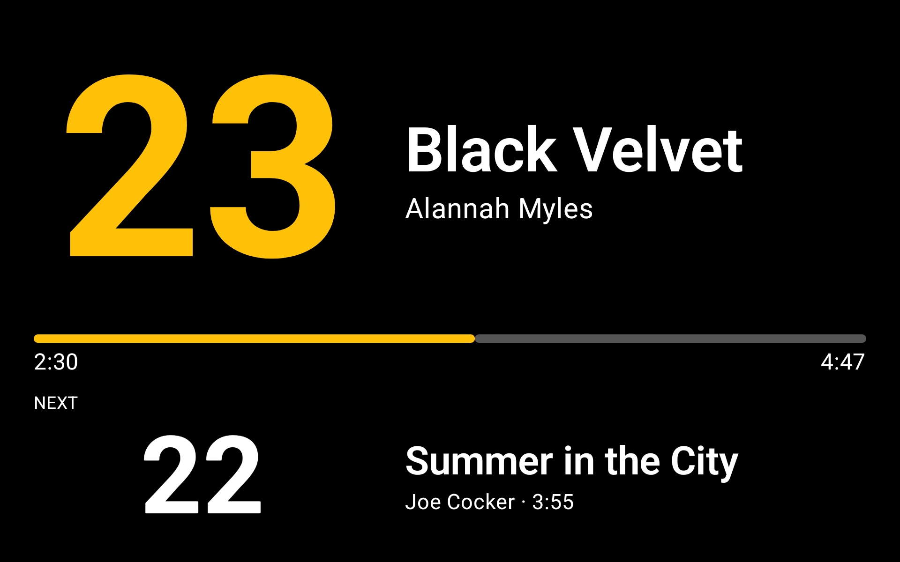

# Teamrowing Display

An Android tablet app that shows the music of a team rowing training session to the participants:
the tempo (strokes per minute) of the current and the next track, title and artist, and the
playback progress.

The trainer plays the music with Spotify on their phone. The tablet only displays what is playing,
reading it from the Spotify Web API with the same Spotify account.

It's the counterpart of [teamrowing-remote](https://github.com/martingregoire/teamrowing-remote),
which the trainer uses on the phone to control Spotify and correct the tempo of the tracks.



## Features

- **Display:** large tempo, title and artist of the current track, progress bar with position and
  duration, and the next track. Tap the screen to show the controls.
- **Session preparation:** each Spotify playlist is one training session. The app looks up the BPM
  of its tracks ([ReccoBeats](https://reccobeats.com) by Spotify ID, [Deezer](https://www.deezer.com)
  by ISRC as fallback), and the trainer corrects them to the rowing tempo with ÷2, ×2, −1 and +1,
  types a value, or marks a track as "No tempo", e.g. for stretching.
- **Display settings:** shown elements, tempo size, current/next split, color scheme and accent
  color, with a live preview.
- **Tablet mode:** the screen stays on and the system bars are hidden while the app is open.
- **Sync with the remote app:** the BPM values are synced over Bluetooth with
  [teamrowing-remote](https://github.com/martingregoire/teamrowing-remote) on the trainer's phone,
  which shows each track's tempo and can correct it too. While it's connected, it also reports track changes, pause and
  seeking instantly, so the display doesn't have to wait for its next poll. The status is shown
  with the controls.
- Spotify's autoplay tracks after the end of a playlist are not shown as next track.

BPM values and corrections are stored per Spotify track, so a corrected song keeps its tempo in
every session. They are stored on the tablet and, once synced, on the phone, so either device can
restore the other's data.

## Bluetooth sync

- Pair the tablet and the phone once in Android's Bluetooth settings, and allow the "Nearby
  devices" permission when the apps ask for it.
- While the display app is open, it accepts the remote app's connection (RFCOMM). On connecting,
  both apps send all their BPM entries, then each change as it happens (lookups and corrections on
  the tablet, corrections on the phone), one JSON message per line.
- The remote app also sends its playback state (track, position, play/pause, playlist) on every
  change. While it's connected, the display app takes the current track from it and only fetches
  the queue from the Web API, retrying shortly while Spotify still reports the previous track's
  queue. Without the remote app, it polls the playback state as before.
- Entries are merged per track: a detected BPM is taken from whichever device has one, and the
  trainer's correction and "No tempo" from the more recently edited one.
- The protocol and the BPM entry format (`sync/SyncSession.kt`, `bpm/BpmEntry.kt`) are kept
  identical in both apps.

## Requirements

- A Spotify Premium account, and the Spotify app on the trainer's phone to play the music. The
  tablet logs in with the same Spotify account.
- An Android tablet with Android 8.0 (API 26) or newer.
- The app isn't published: whoever builds it (see [Development setup](#development-setup)) must
  add the trainer's Spotify account to their Spotify app in the Developer Dashboard. In
  Development Mode, up to 5 Spotify users can be added there.
- Optional: [teamrowing-remote](https://github.com/martingregoire/teamrowing-remote) on the phone,
  to correct tempos there and to show track changes instantly. The tablet needs Bluetooth for
  this. Without it, the display polls Spotify for the playback state.

## Setup

- Turn off Spotify's *Autoplay* on the phone that plays the music (Settings → Playback), so no
  unrelated music plays after a session.
- For the remote app, pair the tablet and the phone once, as described in
  [Bluetooth sync](#bluetooth-sync).

## Development setup

- A Spotify app registered in the
  [Spotify Developer Dashboard](https://developer.spotify.com/dashboard) (Web API, redirect URI
  `teamrowing-display://callback`), with each trainer's Spotify account added as a user.
- [mise](https://mise.jdx.dev) provides the JDK (`mise.toml`) and puts the Android SDK tools on the
  `PATH`. Run `mise install` once in the project directory.
- [Android Studio](https://developer.android.com/studio) installs the Android SDK to `~/Android/Sdk`
  and provides the emulator.
- The Spotify client ID goes into `~/.gradle/gradle.properties`, outside the repository:

  ```properties
  teamrowingDisplay.spotifyClientId=<client ID from the Spotify dashboard>
  ```

No client secret is needed: the app logs in with the Authorization Code flow with PKCE.

Build and install a debug version on a running emulator or connected device:

```sh
./gradlew installDebug
```

## Release build

Android requires release APKs to be signed, and updates must be signed with the same key.

1. Create a signing key once, and keep the file and password safe (e.g. in a password manager).
   Without them, an update can only be installed after uninstalling the app, which deletes the
   prepared BPM values and the display settings.

   ```sh
   keytool -genkeypair -v -keystore ~/.android/teamrowing-release.jks \
     -alias teamrowing -keyalg RSA -keysize 4096 -validity 36500
   ```

2. Add the key to `~/.gradle/gradle.properties`:

   ```properties
   teamrowingDisplay.releaseKeystore=~/.android/teamrowing-release.jks
   teamrowingDisplay.releaseKeystorePassword=<keystore password>
   teamrowingDisplay.releaseKeyAlias=teamrowing
   ```

3. Build the APK:

   ```sh
   ./gradlew assembleRelease
   ```

   The signed APK is `app/build/outputs/apk/release/app-release.apk`. Without the signing
   properties, Gradle builds an unsigned `app-release-unsigned.apk`, which can't be installed.

4. Install it on the tablet, either with USB debugging enabled:

   ```sh
   adb install -r app/build/outputs/apk/release/app-release.apk
   ```

   or by copying the APK to the tablet and opening it there, allowing the file manager to install
   unknown apps when asked.

Build updates from a release tag (see [Releasing](#releasing)), whose version Android accepts as
newer than the installed one.

## Releasing

The changes of each version are listed in [CHANGELOG.md](CHANGELOG.md). Releases are git tags
like `v1.2.3`, from which Gradle takes the app's version: `versionName` is the tag (with the number
of commits since then and the commit for builds after it, e.g. `1.2.3-4-gabc1234`, and `-dirty`
with uncommitted changes), `versionCode` is `major * 10000 + minor * 100 + patch`. Without a tag,
the version is `0.0.0`.

Versions follow [Semantic Versioning](https://semver.org): the major version increases when the
Bluetooth protocol or the BPM entry format changes so that the other app has to be updated too,
the minor version with new features, and the patch version with fixes. The changelog notes which
version of [teamrowing-remote](https://github.com/martingregoire/teamrowing-remote) a version
needs.

1. Note each change under `## [Unreleased]` in `CHANGELOG.md`, in the same pull request.
2. For a release, rename that section to the version and date, e.g. `## [1.2.0] - 2026-11-02`, add
   a new empty `## [Unreleased]` above it, and update the links at the end of the file.
3. Once that's merged, tag the commit on `main` and push the tag:

   ```sh
   git tag v1.2.0
   git push origin v1.2.0
   ```

The [release workflow](.github/workflows/release.yml) then creates a GitHub release with the
version's changelog section as release notes. No APK is attached: it would only log in with the
Spotify app it was built for (see [Requirements](#requirements)), so everyone builds their own.

## License

Licensed under the [Apache License 2.0](LICENSE).
